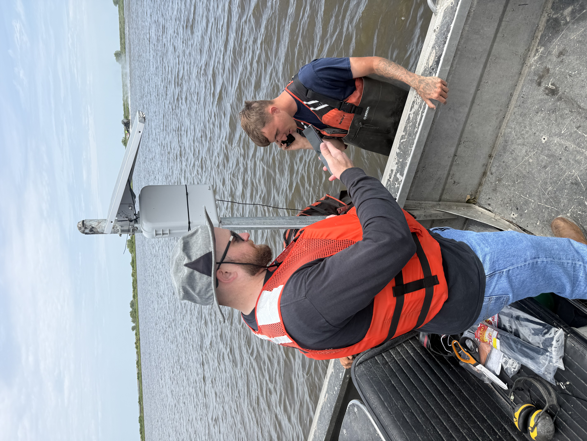
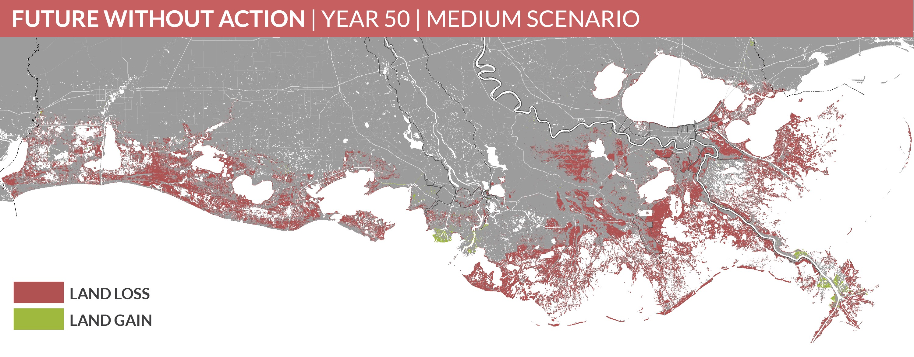
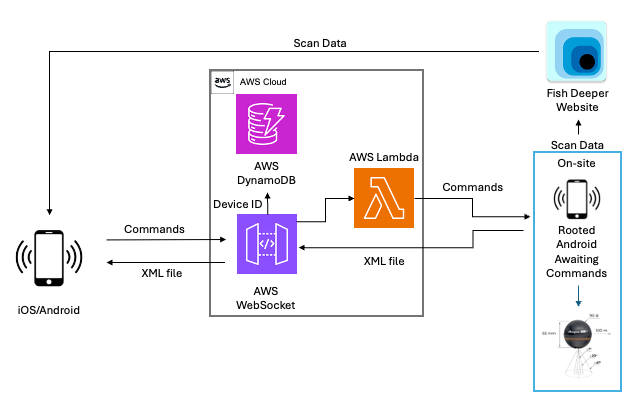
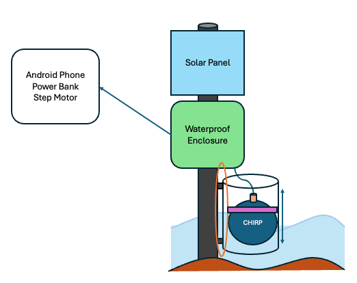
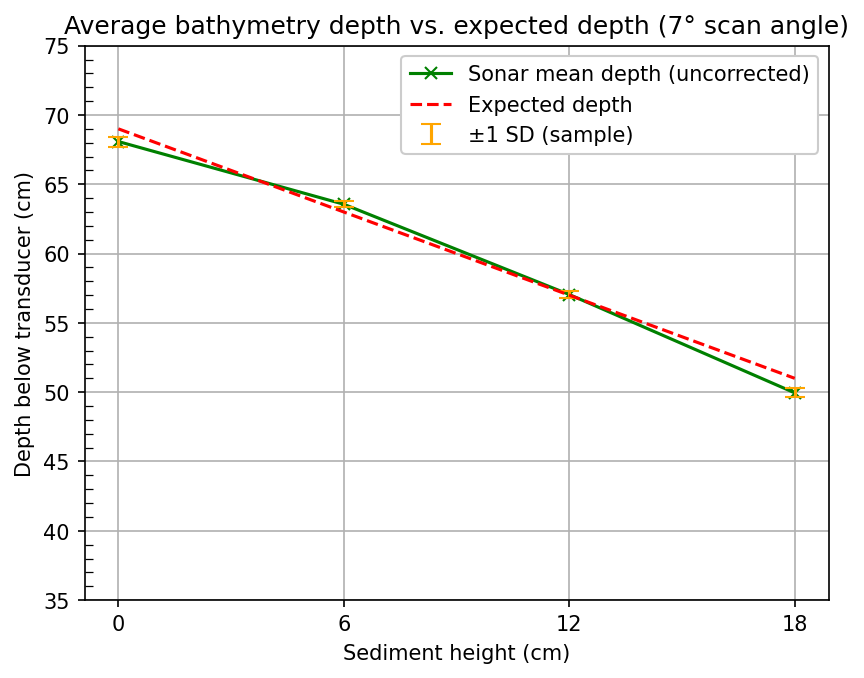
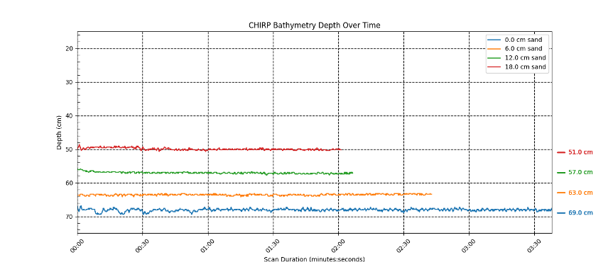
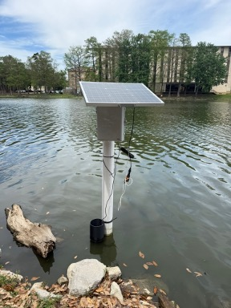
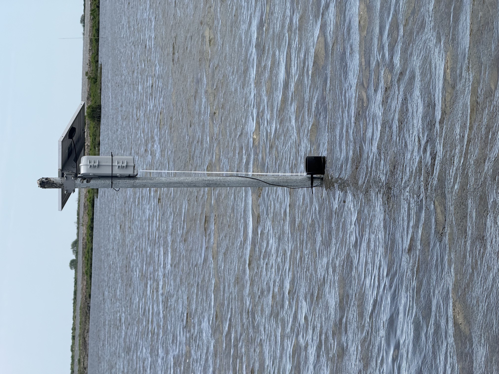

# Developing a Software-based CHIRP Sonar System to Track Mudline Elevation During Dredging

A software-based CHIRP sonar system for tracking mudline elevation in real time during marsh creation dredging on the Louisiana coast.

> Based on the Master's thesis _"Developing a Software-based CHIRP Sonar System to Track Mudline Elevation During Dredging"_ — Ikaika Lee, Department of Computer Science and Engineering, Louisiana State University, Spring 2026.

<!-- After the first Zenodo release, add the concept-DOI badge here, e.g.
[](https://doi.org/10.5281/zenodo.XXXXXXX) -->

> [!IMPORTANT]
> **There is no hosted instance and no public backend.** The apps talk to an AWS backend (API Gateway, Lambda, DynamoDB, S3) that you deploy yourself. Until you do, you can only run the [analysis notebook](data_visualization) and the [tests](#running-the-tests). See [Configuration after cloning or forking](#configuration-after-cloning-or-forking).

**Quick links:** [Data processing](#data-processing) · [Data dictionary](docs/data-dictionary.md) · [How to cite](#how-to-cite) · [License](#license) · [Changelog](CHANGELOG.md)

<p align="center">
  
</p>

## Background

Louisiana lost roughly 2,000 square miles of coastal wetlands between 1930 and 2023, at an average annual cost of $15.2 billion. Without improved intervention, projections estimate another 3,000 square miles lost by 2073, at up to $24.3 billion a year.

Marsh creation projects fight this by pumping dredged sediment into contained areas to build new, elevated land. Today that process is monitored with **Instrumented Settlement Plates (ISPs)** — vibrating wire piezometers and pressure cells that measure soil consolidation. ISPs are accurate, but they have a blind spot: they only produce meaningful data _after_ dredging finishes, and provide no insight into sediment transport or mudline consolidation while dredging is actively happening.



## What this project does

Chirp pairs a commercial CHIRP (Compressed High-Intensity Radiated Pulse) sonar with a cloud-connected control system to close that gap, giving engineers real-time visualization of the mudline as it forms during active dredging. Because CHIRP sonar uses pulse compression, it can filter out the acoustic "noise" of suspended sediment and lock onto the true sediment-water interface, even in high-turbidity slurry.

### Research objectives

1. **Obj1 — System development:** Engineer a cloud-based sonar system, built on a commercial CHIRP transducer, that can be controlled remotely and scan under any field conditions.
2. **Obj2 — Deployment:** Deploy and validate the system in real-world conditions, capturing engineering data during active dredging and zone settling.

## How it works

The sonar hardware itself is a commercial, off-the-shelf transducer with proprietary, closed firmware — it only speaks to its own companion app over Wi-Fi. To make it remotely controllable, Chirp treats a rooted Android phone as a physical proxy: commands sent from a mobile app are translated into simulated taps and swipes (`input tap` / `input swipe`) on the proprietary sonar app, and the phone's UI hierarchy (XML) is captured and streamed back so the controller can confirm state and decide the next action.

```
 ┌───────────────┐  commands   ┌─────────────┐   WebSocket   ┌──────────────────┐
 │  Flutter      │ ──────────▶ │ AWS Lambda /│ ────────────▶ │  Rooted Android  │
 │  mobile app   │             │  WebSocket  │               │  on-site device  │
 │ (iOS/Android) │◀──────────  │  (AWS Cloud)│◀────────────  │  + CHIRP sonar   │
 └───────────────┘  scan data  └──────┬──────┘  XML / scans  └──────────────────┘
                                      │
                                      ▼
                                ┌─────────────┐
                                │  DynamoDB   │
                                │ (device IDs,│
                                │  scan data) │
                                └─────────────┘
```



### Hardware

- Waterproof enclosure with cable glands for all electronics
- CHIRP sonar transducer
- Solar panel + power bank for sustained, self-sufficient field power
- Step motor to raise/lower the sonar in and out of the water (working around the locked firmware)
- Rooted Android phone as the on-site communication gateway



#### 3D-printed parts

The STL files for the custom 3D-printed parts needed to mount the sonar are in [`STL files/`](<STL files>):

| File                                                                                               | Description                                                                                              |
| -------------------------------------------------------------------------------------------------- | -------------------------------------------------------------------------------------------------------- |
| [`Chirp Guiding Tube.stl`](<STL files/Chirp Guiding Tube.stl>)                                     | Guiding tube for the sonar                                                                               |
| [`Chirp Guiding Tube Rubber Inner Ring.stl`](<STL files/Chirp Guiding Tube Rubber Inner Ring.stl>) | Guiding tube with room for an adhesive inner rubber ring to provide stability to the settling plate pole |
| [`Chirp Mount Beads.stl`](<STL files/Chirp Mount Beads.stl>)                                       | CHIRP harness for attaching the sonar to the beads                                                       |
| [`ChirpRefImg.png`](<STL files/ChirpRefImg.png>)                                                   | Reference cross-section drawing (dimensions in mm) of the sonar housing the parts are sized against      |

### Software stack

| Layer               | Technology                                                                 | Purpose                                                                                                                                    |
| ------------------- | -------------------------------------------------------------------------- | ------------------------------------------------------------------------------------------------------------------------------------------ |
| Mobile app          | [Flutter](https://flutter.dev)                                             | Cross-platform (iOS/Android) app for triggering scans and viewing bathymetry data — see [`chirp_control/`](chirp_control)                  |
| Web app             | [React](https://react.dev) + [TypeScript](https://www.typescriptlang.org/) | Browser-based alternative for triggering scans and analyzing bathymetry/ISP data — see [`chirp-control-web/`](chirp-control-web)           |
| Real-time transport | WebSockets                                                                 | Persistent, full-duplex channel between the mobile/web apps and the on-site device                                                         |
| Cloud               | AWS (Lambda, API Gateway WebSockets, DynamoDB)                             | Hosts the WebSocket connection, routes commands, and stores device IDs and scan data — see [`chirp_control/lambda/`](chirp_control/lambda) |
| Data analysis       | Python / Jupyter                                                           | Post-processing and visualization of bathymetry scan data — see [`data_visualization/`](data_visualization)                                |

## Repository layout

```
COE-CHIRP/
├── chirp_control/           Flutter mobile app for scan control and data analysis
│   ├── lambda/              AWS Lambda functions (auth, sonars, scans, WebSocket) and the
│   │                         on-site controller script remote_control.py
│   └── test/                Unit tests of the depth processing
├── chirp-control-web/       React web app: an alternative way to control scans and analyse data
├── data_visualization/      Notebook, Python modules (chirp_bathymetry, chirp_netcdf) and the
│                             sample-dataset builder for the settling-column tests
├── test-fixtures/           Synthetic bathymetry files, expected results and a NetCDF golden
│                             file shared by the web, mobile and Python tests
├── docs/                    Data dictionary (file formats, units, metadata)
├── STL files/               3D-printable parts (guiding tube, rubber inner ring, mount beads)
├── CITATION.cff             Citation metadata (used by GitHub and Zenodo)
├── CHANGELOG.md             Release notes
└── RELEASING.md             Checklist for tagging a release and archiving it on Zenodo
```

Raw sonar exports are **not** included in the repository. They come from the
sonar vendor's cloud service (see [Input files](#1-input-files)). A sample
dataset (four settling-column runs as raw vendor files and CF-1.8 NetCDF) is
published as a separate Zenodo record, built by
[`data_visualization/build_sample_dataset.py`](data_visualization/build_sample_dataset.py)
(see [`RELEASING.md`](RELEASING.md#sample-dataset-6-can-follow-100)). Until then the synthetic
files in [`test-fixtures/bathymetry/`](test-fixtures/bathymetry) show the
format.

### Output formats

| Format | Written by | Specification |
| ------ | ---------- | ------------- |
| **NetCDF (CF-1.8, ACDD-1.3)**: processed depths, acquisition metadata, processing record and raw echo profiles | Web app (scan analysis → download), `data_visualization/chirp_netcdf.py` | [data dictionary §7](docs/data-dictionary.md#7-netcdf-export-chirp-bathymetry-netcdf10) |
| Annotated CSV with a metadata header | Web app | [§5](docs/data-dictionary.md#5-annotated-csv-export-chirp-bathymetry-csv10) |
| PDF report | Web and mobile apps | — |
| ISP records (JSON) | Web app | [§6](docs/data-dictionary.md#6-isp-export-chirp-isp-export10) |

## Getting started

The mobile app lives in [`chirp_control/`](chirp_control) — see that directory's README for Flutter setup instructions. The web app lives in [`chirp-control-web/`](chirp-control-web) — see that directory's README for setup instructions. Scan data processing notebooks live in [`data_visualization/`](data_visualization).

### Configuration after cloning or forking

The apps and the on-site device script talk to an AWS backend, but the
endpoint URLs are **not** committed to this repository. After cloning or
forking you need to create your own (gitignored) config files before anything
can connect:

| Component                                                                                                  | Copy this template | To this (gitignored) file           | Values to fill in                                                                                                            |
| ---------------------------------------------------------------------------------------------------------- | ------------------ | ----------------------------------- | ---------------------------------------------------------------------------------------------------------------------------- |
| Web app ([`chirp-control-web/`](chirp-control-web))                                                        | `.env.example`     | `.env.local`                        | `VITE_API_BASE_URL` (HTTP API: `/auth`, `/sonars`, `/scans`) and `VITE_WS_URL` (scan-control WebSocket, including the stage) |
| Mobile app ([`chirp_control/`](chirp_control))                                                             | `env.example.json` | `env.json`                          | `API_BASE_URL` and `WS_URL`, same meaning as above                                                                           |
| On-site device script ([`chirp_control/lambda/remote_control.py`](chirp_control/lambda/remote_control.py)) | —                  | `CHIRP_WS_URL` environment variable | The same WebSocket URL (the script appends `?deviceId=...`)                                                                  |

```bash
# Web app
cp chirp-control-web/.env.example chirp-control-web/.env.local

# Mobile app (pass the file at run/build time)
cp chirp_control/env.example.json chirp_control/env.json
flutter run --dart-define-from-file=env.json   # from chirp_control/

# Device script
export CHIRP_WS_URL="wss://<api-id>.execute-api.<region>.amazonaws.com/<stage>"
```

If you don't have a backend yet, you need to deploy your own in AWS. All the
Lambda code, handler names, routes, tables and IAM permissions are documented in
[`chirp_control/lambda/README.md`](chirp_control/lambda/README.md). In short:

- **HTTP API** (API Gateway) with `/auth`, `/sonars` and `/scans` routes
  (`GET`, `POST`, `PUT`, `DELETE` and CORS for `/scans`) pointing at the auth,
  sonar and scan Lambdas.
- **WebSocket API** (API Gateway) for scan control, with its connect,
  disconnect and send-message Lambdas.
- **DynamoDB tables** `ChirpUserAccounts` (key `email`), `RegisteredChirpSonars` (`user_id` + `sonar_id`), `ChirpScans` (`user_id` + `scan_id`) and `ChirpWebSocketConnections` (`deviceId`).
- **S3 bucket** for scan CSVs, with its name set in the scan Lambda's
  `SCANS_BUCKET` environment variable and a CORS rule allowing `GET`.

The Lambdas currently hardcode the `us-east-2` region and the table names above,
so change them in the code if you deploy elsewhere. Never commit your
filled-in `.env.local` or `env.json`; `.gitignore` already excludes them.

## Data processing

This section describes everything the software does to the numbers between
the sonar's export and what the apps and notebook report. The web app
([`bathymetry.ts`](chirp-control-web/src/utils/bathymetry.ts)), the mobile app
([`depth_processing.dart`](chirp_control/lib/utils/depth_processing.dart)) and
the notebook ([`chirp_bathymetry.py`](data_visualization/chirp_bathymetry.py))
implement the same rules. All three are tested against the same fixtures and
expected values ([`test-fixtures/bathymetry/`](test-fixtures/bathymetry)), so
they report the same statistics for the same scan.

### 1. Input files

Each scanning session exported from the vendor's cloud service
(<https://maps.fishdeeper.com>) contains `bathymetry.csv` (one row per depth
reading, the file that is analysed) and `sonar.csv` (raw echo profiles,
stored but not analysed). Columns of `bathymetry.csv`:

| Column | Name in header (if any) | Unit | Reference |
| ------ | ----------------------- | ---- | --------- |
| 0 | `latitude` | decimal degrees | WGS 84 (presumed); `0`/blank = no GPS fix |
| 1 | `longtitude` (vendor spelling) | decimal degrees | as above |
| 2 | `depth` | m | below the transducer face (section 2) |
| 3 | `temperature` | °C | at the transducer |
| 4 | `time` | ms | **Unix epoch, UTC** |

Exports from 2025 have no header row and exports from 2026 do. The software
reads columns **by header name** when there is a header and by the position
above when there is not. It **refuses to import** a file that matches neither,
rather than plotting the wrong column. Note that the `README` the vendor puts
in each export swaps columns 3 and 4; the files themselves follow the table
above. The full schema, including `sonar.csv`, is in the
[data dictionary](docs/data-dictionary.md).

### 2. Depth reference

The reported depth is the **distance from the transducer face down to the
bottom detected by the sonar**. The vendor does not publish its
bottom-detection algorithm. Depth is **not** a mudline elevation. To convert
it, record the transducer elevation with the scan (scan analysis screen →
*Acquisition settings*, see [data dictionary §4](docs/data-dictionary.md#4-acquisition-metadata)):

```
mudline elevation = transducer-face elevation − (reported depth + blind-spot offset)
```

where the transducer-face elevation is relative to a stated vertical datum
(e.g. NAVD88) **at the time of the scan, with the step motor in its lowered
position**. For a sonar mounted on a settlement plate the plate settles with
the foundation soil, so

```
transducer-face elevation(t) = surveyed plate elevation at installation
                               − plate settlement at time t (from the ISP)
                               + height of the transducer face above the plate
```

When a transducer elevation is recorded, the apps show the settled mudline
elevation and the CSV export includes a `mudline_elevation_m` column.

### 3. Instrument corrections

Sonars have a short blind zone just below the transducer. In the
settling-column tests ([`data_visualization/README.md`](data_visualization/README.md))
the **Deeper CHIRP+/Max read correct depths without adjustment**, while the
**Deeper PRO+ 2 needed about a 5 cm adjustment**.

**By default no correction is applied: depths are shown exactly as the sonar
reported them.** A correction is applied only when a *blind-spot offset* is
entered in a scan's acquisition settings. The offset is signed, in cm, and
**added** to every reading of that scan. It is stored with the scan and printed
in the PDF report and the CSV export, so the correction is always visible. The
notebook has the same option (`BLIND_SPOT_OFFSET_CM`, default 0).

### 4. Cleaning

Applied, in order, every time a scan is displayed (raw files are never
modified):

1. **Incomplete rows are skipped.** A row with a blank depth or time is skipped and counted.
2. **Samples are sorted by time.**
3. **Isolated time islands at the start or end are removed.** Some scans log a
   few samples before the phone's clock syncs, or after it drifts on
   reconnect, leaving them seconds to minutes away from the rest. A leading
   or trailing group of samples is dropped when **both** of these hold:
   - the time gap separating it from the rest is ≥ max(20 × the median sample spacing, 0.15 × the scan's total time span), and
   - the group holds ≤ 15 % of the samples.

   Scans with fewer than 10 samples are never trimmed.

**The number of rows skipped and trimmed is shown on the scan analysis screen
(*Processing* card), in the PDF report, and in the CSV export.** Charts,
statistics and settled depth are all computed from the same remaining samples.

Gaps inside a scan (sensor paused, reconnect) are **not** removed. On charts,
consecutive samples more than max(3 × median spacing, 1 s) apart are drawn as
separate line segments rather than joined, and no values are interpolated
into the gap.

### 5. Derived quantities

All computed from the cleaned samples of section 4, in cm (converted to inches
when the imperial unit setting is chosen), **after** any blind-spot offset:

| Quantity | Definition |
| -------- | ---------- |
| Average | Arithmetic mean of all samples |
| SD | Sample standard deviation (n − 1 denominator) |
| Minimum / maximum | Smallest / largest sample |
| Samples (n) | Number of samples used |
| Settled depth | Mean of the samples in the **last 30 seconds** of the scan, by timestamp (`SETTLED_WINDOW_S`). A fixed time window means the same thing at any sampling rate. |
| Depth change (Compare scans) | Settled depth of the **chronologically latest** scan minus that of the **earliest** (ordered by each scan's first timestamp, not by selection order). Because depth points downward, **a negative change means the mudline rose** toward the sonar (deposition), and a positive change means it fell (consolidation, settlement or erosion). The screen names the two scans used. |
| Mudline elevation | See section 2. Shown only when a transducer elevation is recorded. |

> **Changed in 1.0.0:** previously the settled depth was the mean of the last
> 20 rows in file order, the depth change was the unsigned max − min of the
> settled depths, and the statistics included samples that the chart had
> trimmed. On the four settling-column scans the averages are unchanged and
> the settled depths differ by at most 0.21 cm. See [`CHANGELOG.md`](CHANGELOG.md).

### 6. Uncertainty

The notebook's *Average depth vs. sediment height* plot shows each scan's
mean depth with error bars of **±1 sample standard deviation** (`ddof=1`) of
the individual readings, and prints the number of readings *n* for each scan.
This is the scatter of single readings. The standard error of the mean
(SD/√n) is much smaller, but readings about 70 ms apart are autocorrelated, so
SD/√n understates the true uncertainty of the mean. The apps report the same
SD and *n*. Versions before 1.0.0 drew asymmetric error bars (0.9 σ below,
1.15 σ above, population σ). Those factors had no justification and have been
removed.

### 7. Limitations

- **Minimum water depth.** The sonar does not read in shallow water ("Sonar too shallow"). The settling-column tests used at least 30 cm (1 ft) of water.
- **Start-up with suspended sediment.** When sediment is added, the sonar cannot read for about 1 minute and then reads the suspended sediment for 2–3 minutes before the mudline is detected reliably. Scan for at least 5 minutes and use the settled depth, not the average, in these conditions.
- **Walls and mounting.** The sonar stops reading when it is too close to a side wall. Keep it centred and at a constant, recorded height.
- **Vendor dependence.** The bottom-detection algorithm, any sound-speed (temperature or salinity) compensation, and the export format are controlled by the vendor and not documented. The raw data pass through the vendor's closed cloud service. Format changes are caught by the import validation (section 1), but changes to the algorithm would not be.
- **Phone clock.** Sample times come from the phone running the companion app. Clock jumps produce the time islands handled in section 4.
- **ISP data** imported in the web app are stored only in that browser (see the [web app README](chirp-control-web/README.md#isp-data)).

## Running the tests

| Component | Command | What it checks |
| --------- | ------- | -------------- |
| Web app | `cd chirp-control-web && pnpm install && pnpm test` | Schema validation, cleaning, statistics, settled depth, signed depth change, CSV export round-trip, NetCDF output against the golden file |
| Mobile app | `cd chirp_control && flutter test` | The same rules in Dart, against the same fixtures |
| Python modules | `cd data_visualization && pip install -r requirements.txt && python -m pytest -q` | The same rules in Python, against the same fixtures; the Python NetCDF exporter reproduces the web app's golden file |

The fixtures and their expected values are generated by
[`test-fixtures/bathymetry/generate.py`](test-fixtures/bathymetry/generate.py),
an independent reference implementation of the rules above. The same checks
run on every push via GitHub Actions ([`.github/workflows/tests.yml`](.github/workflows/tests.yml)),
which also checks the NetCDF golden file against CF-1.8 at the strict level.

## Testing & validation

The system was validated in two phases:

1. **Laboratory settling column tests** — a transparent settling column filled with water and site-specific dredged sediment, with the sonar mounted above and facing down, was used to calibrate the system and confirm it could track the mudline as it elevated during settling, even through heavy suspended slurry.
2. **Local field deployment** — the fully assembled system (enclosure, solar power, step motor, and rooted phone) was deployed to validate end-to-end automation and resilience against intermittent cellular connectivity.

### Depth accuracy across consistent sand heights

Mean sonar depth of each settling-column scan (7° scan angle, no blind-spot correction) against the depth expected from the measured water and sand heights. Error bars are ±1 sample standard deviation of the individual readings (n = 1,620–3,018 per scan); see [Uncertainty](#6-uncertainty).



### Depth accuracy across consistent sand heights over time



### Local field deployment at LSU lakes



### Sonar system installed at the dredging site



Results confirmed that sonar visualization of an elevating mudline is possible and that the system is stable enough to be deployed in the field.

## Conclusions & future work

By wrapping a commercial CHIRP sonar in an app-controllable, cloud-connected system, engineers can trigger a scan from anywhere and get real-time mudline data during active dredging — something ISPs alone can't provide. That real-time visibility lets project teams catch fill overruns or underruns as they happen, rather than discovering them after the fact.

Relying on commercial hardware with closed firmware introduced real costs: brittle UI-automation-based control, and communication latency across phone → WebSocket → cloud → phone round trips. The clear next step is custom hardware — a standalone CHIRP transducer wired directly to a microcontroller (e.g. an ESP32 or Raspberry Pi Compute Module) with its own LTE modem — to remove the smartphone middleman entirely, extract raw acoustic backscatter, and cut power draw for longer field deployments.

## How to cite

If you use this software, please cite it. The citation metadata are in
[`CITATION.cff`](CITATION.cff), and GitHub's **"Cite this repository"** button
gives APA and BibTeX. Each release is archived on Zenodo with a DOI. Cite the
version DOI of the release you used, or the concept DOI to refer to all
versions. *(The DOI will be added here after the first release.)*

Please also cite the thesis:

> Lee, I. (2026). *Developing a Software-based CHIRP Sonar System to Track Mudline Elevation During Dredging* [Master's thesis, Louisiana State University].

## License

**No license has been chosen yet.** The license is being confirmed with LSU
and the project sponsor. Until a `LICENSE` file is added, the code is under
default copyright ("all rights reserved") and may not be reused, modified or
redistributed without permission. Third-party images and logos are not
covered by any future code license; see [`RELEASING.md`](RELEASING.md).

## Acknowledgments

**Special thanks:** Dr. Celalettin Emre Ozdemir, Dr. Navid H Jafari

<!-- Funding: add the sponsor and award/contract number here and in
CITATION.cff once confirmed. -->
