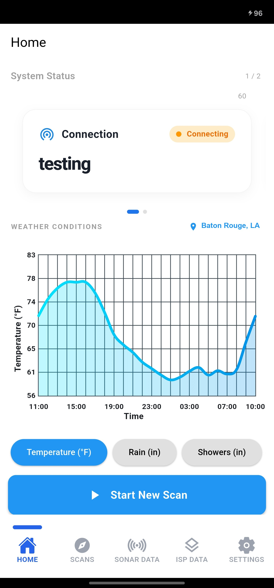
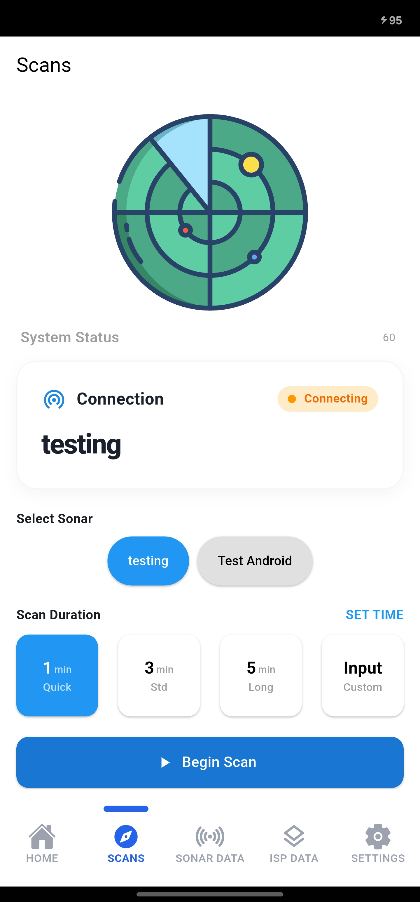
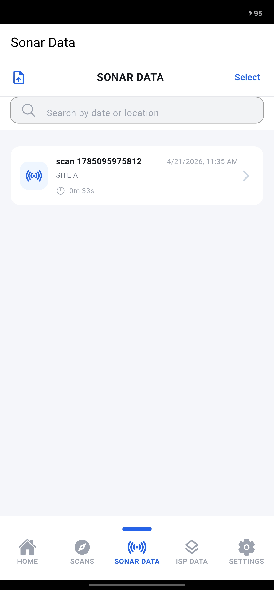
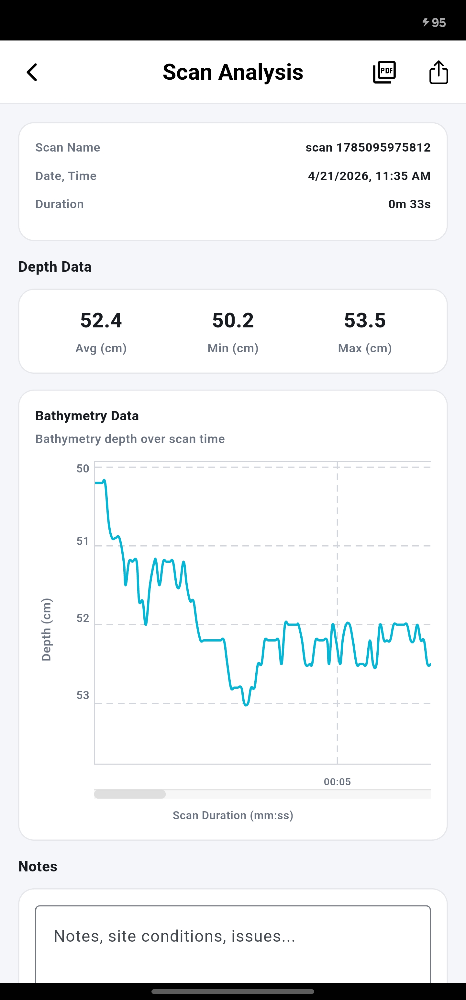

# Flutter App for Sonar Control

Flutter mobile app for the [CHIRP](../README.md) sonar system — triggers scans, shows live and historical bathymetry data, and manages registered on-site sonars. This directory also holds the AWS/on-site controller code in [`lambda/`](lambda).

See the [root README](../README.md) for the full system architecture and background. This document covers how to set up and run the pieces that live in this directory.

## Screenshots

| Home | Scans | Sonar Data | Scan Analysis |
| :---: | :---: | :---: | :---: |
|  |  |  |  |

## Project layout

```
chirp_control/
├── lib/
│   ├── screens/       auth, home, scan, data (scan list), chart (scan analysis),
│   │                   compare_scan, isp_data, isp_analysis, settings, sonar_sensors
│   ├── components/    nav_bar, scan_duration_input, system_status_card,
│   │                   weather_graph, acquisition_card
│   └── utils/         depth_processing (all depth parsing/cleaning/statistics,
│                       see "Data processing" in the root README), acquisition,
│                       scan_repo, import_scan, isp_repo, import_isp, xlsx_reader,
│                       websocket_controller (app <-> AWS WebSocket),
│                       sonar_repository, auth_repository, units_repository,
│                       alert_prefs, config
├── test/              depth_processing_test (shared fixtures in ../test-fixtures)
├── assets/            app assets + the images used in the root README
└── lambda/            AWS Lambda functions (auth, sonar, scan, WebSocket
                        connect/disconnect/send-message) and remote_control.py,
                        which is NOT a Lambda: it runs on-site (see below)
```

### Where the mobile app keeps data

Scans and ISP records imported or recorded in the mobile app are stored **on
the device only** (`<app documents>/scans/` and `<app documents>/isp/`). They
are not uploaded to the backend and do not appear in the web app. The mobile
app uses the backend for account login (`/auth`), the sonar registry
(`/sonars`) and scan control (WebSocket). The file layout is described in the
[data dictionary](../docs/data-dictionary.md#3-scan-records).

The scan analysis screen shows how its numbers were computed (rows used,
skipped and trimmed; blind-spot correction) and lets you record the scan's
**acquisition settings** (sonar model, firmware, beam mode, transducer
elevation and datum, blind-spot offset). Both are included in the PDF report.

## Prerequisites

- [Flutter SDK](https://docs.flutter.dev/get-started/install) (this project targets `sdk: ^3.8.1`; developed and tested with **Flutter 3.47.7**, the version CI uses). Run `flutter doctor` after installing. Newer Flutter releases deprecate `package:flutter/material.dart`; `flutter analyze` then reports info-level hints in every file, but the app still builds.
- Xcode (for iOS) and/or Android Studio + SDK (for Android), whichever platform you're building for
- An AWS account if you're standing up your own backend (DynamoDB, API Gateway, Lambda)
- A CHIRP sonar - this project used Fish Deeper's CHIRP Max
- A rooted Android phone with the sonar's companion app installed — this project was built against [Fish Deeper](https://deepersonar.com) (`eu.deeper.fishdeeper`)
- Python 3 with `uiautomator2` and `websockets` on whichever machine runs `lambda/remote_control.py`

## 1. Flutter app setup

1. Install dependencies:

   ```
   flutter pub get
   ```

2. Point the app at your AWS backend. The endpoint URLs are supplied at build time and kept out of git:

   ```
   cp env.example.json env.json   # env.json is gitignored
   ```

   Then fill in `env.json`:
   - `API_BASE_URL` — the HTTP API Gateway invoke URL used for `/auth` and `/sonars` (the web app also uses `/scans` on the same API)
   - `WS_URL` — the WebSocket API Gateway invoke URL, including its stage (e.g. `.../test`)

   These are read in `lib/utils/config.dart`.
3. Run it, passing the config file:

   ```
   flutter run --dart-define-from-file=env.json
   ```

   Or build a release artifact with `flutter build apk --dart-define-from-file=env.json` / `flutter build ios --dart-define-from-file=env.json`.

## 2. AWS backend setup

The mobile app, the web app and the on-site device share one backend. Every
function, route, DynamoDB table, key and IAM permission is documented in
[`lambda/README.md`](lambda/README.md). In short:

- **HTTP API** (API Gateway): `POST /auth` → `auth_handler.py`,
  `GET|POST|DELETE /sonars` → `sonar_handler.py`,
  `GET|POST|PUT|DELETE /scans` → `scan_handler.py` (used by the web app).
- **WebSocket API** (API Gateway, stage `test`): `$connect` →
  `connect_handler.py`, `$disconnect` → `disconnect_handler.py`, `$default` →
  `send_message_handler.py`. It relays commands from the app to the on-site
  device identified by `?deviceId=<id>`, and streams XML and scan state back.
- **DynamoDB tables**: `ChirpUserAccounts`, `RegisteredChirpSonars`,
  `ChirpScans`, `ChirpWebSocketConnections` (+ GSI `connectionId-index`).
- **S3 bucket** for the web app's scan CSVs (`SCANS_BUCKET`).

Note the WebSocket invoke URL and stage. You need it both in the app (`WS_URL`
in `env.json`) and on the on-site controller (the `CHIRP_WS_URL` environment
variable for `remote_control.py`).

## 3. On-site rooted Android device setup

`remote_control.py` lives in `lambda/` for repo organization, but it is **not** an AWS Lambda — it's the script that runs on-site to bridge the WebSocket connection to the physical phone.

1. Root the phone and install the sonar's companion app (`eu.deeper.fishdeeper` by default — update the `APP` constant in `remote_control.py` if you're targeting a different app).
2. Install and initialize `uiautomator2` against the device:

   ```
   pip install uiautomator2 websockets
   python -m uiautomator2 init
   ```

3. Set the WebSocket URL and update the constants at the top of `lambda/remote_control.py`:
   - `CHIRP_WS_URL` (environment variable, e.g. `export CHIRP_WS_URL=wss://<api-id>.execute-api.<region>.amazonaws.com/<stage>`) — your WebSocket API Gateway invoke URL; the script appends `?deviceId=<id>`
   - `DEVICE_ID` — must match the sonar you register in the app's Settings screen
   - `APP` — the sonar app's package name, if different from Fish Deeper
4. Run it on-site:

   ```
   python remote_control.py
   ```

   It holds a persistent WebSocket connection with automatic reconnect/backoff, and needs `su` access to issue `input tap` / `input swipe` / Wi-Fi toggles and to read back the phone's UI hierarchy after each command.

## Tests

```
flutter test
```

runs [`test/depth_processing_test.dart`](test/depth_processing_test.dart),
which checks parsing, schema validation, cleaning, statistics, settled depth
and the signed depth change against the fixtures shared with the web app and
the notebook ([`../test-fixtures/bathymetry/`](../test-fixtures/bathymetry)).

## Data processing, export and visualization

How depths are read, cleaned and summarised is documented in the root README,
section [Data processing](../README.md#data-processing). Settling-column scans
are analysed separately in [`data_visualization/`](../data_visualization).

