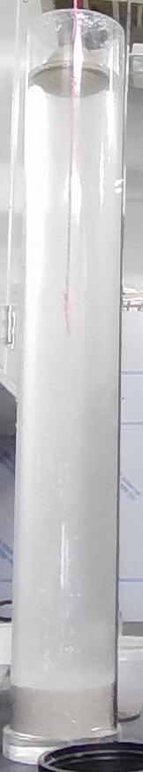
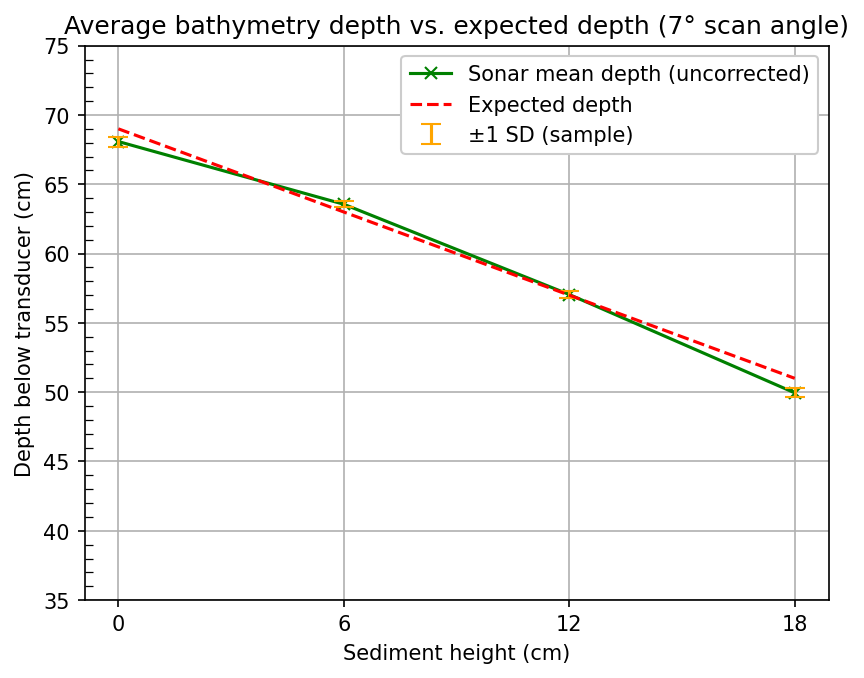
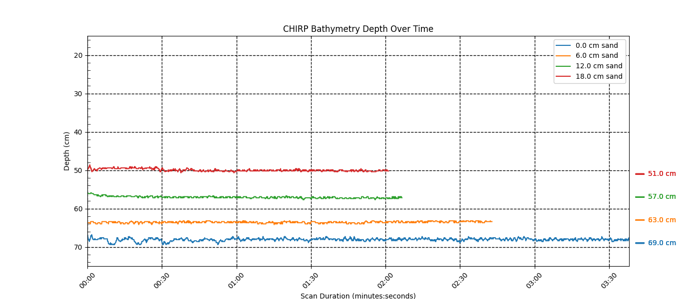
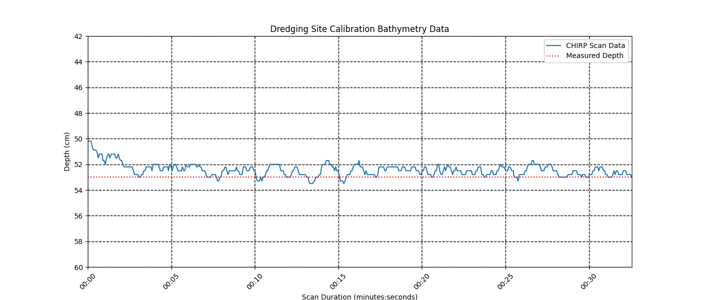

# Settling-column tests and analysis

Laboratory procedures used to validate the CHIRP sonar in a settling column,
and the notebook that analyses the resulting scans.

- [Setup](#setup): install the Python requirements
- [Test procedures](#purely-bathymetry-testing-without-suspended-sediment)
- [Analyzing data](#analyzing-data-through-data_processingipynb) with `data_processing.ipynb`
- [NetCDF export](#netcdf-export) and the [sample dataset](#building-the-sample-dataset)

How depths are read, cleaned and summarised is defined in the root README,
section [Data processing](../README.md#data-processing). The notebook applies
those rules through [`chirp_bathymetry.py`](chirp_bathymetry.py), which is
tested against the same fixtures as the web and mobile apps.

## Setup

Python 3.13 (see [`.python-version`](.python-version)):

```bash
cd data_visualization
python -m venv .venv && source .venv/bin/activate
pip install -r requirements.txt
python -m pytest -q          # tests of chirp_bathymetry.py
jupyter lab data_processing.ipynb
```

## Environment

These tests were performed utilizing a 4 foot settling column with a yard stick taped to the side. The CHIRP sonar was mounted using the included attachment bolts tied with a string, suspending it at a consistent height while keeping it centered in the settling column — equal spacing from each side and a consistent height allowed for accurate measuring and observations.



## Overall Limitations

Because the CHIRP sonar sold by Deeper, which was used in this system, stops scanning when too close to the side or bottom of the settling column it becomes necessary to keep the sonar in the middle of the settling column. This was accomplished using the mounting method described above in "Environment". The method isn't important as long as the CHIRP sonar stays centered in the settling column and at a consistent height for data evaluation.

---

## Purely bathymetry testing without suspended sediment

**Step 1:** Fill settling column with your desired amount of water

> Note: The height of the water must be at least one foot to accommodate for the CHIRP sonar's inability to scan in shallow water.

**Step 2:** Add your desired amount of sand making sure to flatten the sand if possible

> Reminder: The addition of sand will increase the height of the water making it necessary to remove water between each iteration of adding sand to keep the CHIRP height consistent with the water height in step 1.

**Step 3:** Mount the sonar either using the centering method described above in "Environment" (attachment bolts + string) or another method ensuring it stays centered and at a consistent height.

> Note: Remember to record the sonar's scan angle used for this run — it's needed later to name the scan file (see the `scan_degree` naming convention in the "Analyzing Data" section below). The scan angle can be changed via the app and will affect the way the sonar behaves in the tests.

**Step 4:** Perform a scan which should provide an accurate depth reading of the sand in the settling column.

> Note: At the time of writing, the Deeper CHIRP+/Max reads the depth accurately without adjustment, while the Deeper Sonar PRO+ 2 needs an adjustment of about 5 cm for the blind spot just below the transducer. **Neither the apps nor the notebook apply this automatically.** Record the offset in the scan's acquisition settings (apps) or set `BLIND_SPOT_OFFSET_CM` (notebook). See [Instrument corrections](../README.md#3-instrument-corrections).

**Step 5:** End the scan, remove the CHIRP sonar from the settling column and repeat steps 2 - 4 until the desired number of tests have been completed. The majority of tests performed in this project used 5 iterations.

---

## Bathymetry tests in the presence of suspended sediment

**Step 1:** Fill settling column with your desired amount of water

> Note: The height of the water must be at least one foot to accommodate for the CHIRP sonar's inability to scan in shallow water.

**Step 2:** Add your desired amount of sand making sure to flatten the sand if possible

> Reminder: The addition of sand will increase the height of the water making it necessary to remove water between each iteration of adding sand to keep the CHIRP height consistent with the water height in step 1.

**Step 3:** Measure the desired amount of silt, clay, or any other lightweight sediment types.

**Step 4:** Add the silt while quickly adding the CHIRP sonar back to the settling column to begin scanning.

> Note: Remember to record the sonar's scan angle used for this run — it's needed later to name the scan file (see the `scan_degree` naming convention in the "Analyzing Data" section below). The scan angle can be changed via the app and will affect the way the sonar behaves in the tests.

> Note: Once scanning is initiated it is likely the CHIRP will be unable to perform any scans right away. This is due to the suspended sediment sitting too close to the sonar as it begins to settle. This should manifest in a "Sonar too shallow" error. This error will only persist for ~1 minute. Following this period of inability to scan the sonar will the begin to detect the suspended sediment affecting the bathymetry readings for 2 - 3 minutes before the suspended sediment settles to the point of accurate measurements. It is recommended to allow the sonar at least 5 minutes when performing tests with suspended sediment to allow for the sediment to settle and accurate measurements to be gathered.

**Step 5:** End the scan, remove the CHIRP sonar from the settling column and repeat steps 2 - 4 until the desired number of tests have been completed. The majority of tests performed in this project used 5 iterations.

---

## A Few Performed Tests

### Sand Only

---

**Setup:** Fill the settling column with 5 cm of sand and 65 cm of water. Rest the CHIRP sonar at the water's surface (~ 70 cm).

**Procedure:**

1. Scan for 2 - 5 minutes, then end the session and remove the CHIRP.
2. Add another 5 cm of sand.
3. Remove 5 cm of water to offset the added sand, keeping the surface at ~ 70 cm.
4. Replace the CHIRP and scan again.
5. Repeat steps 1 - 4 until the desired number of tests is complete.

**Expected result:** The sonar data should show the sediment height increasing with each iteration, representing a rising mudline during dredging.

---

### Sand and Silt

---

**Setup:** Fill the settling column with 5 cm of sand and 65 cm of water. Rest the CHIRP sonar at the water's surface (~ 70 cm). Measure 200g of silt.

**Procedure:**

1. Pour 200g of silt into the settling column then begin scan.
2. Allow ~ 5 minutes minimum for test containing silt as the first ~ 2 minutes are heavily affected by the suspended sediment.
3. Settling column water level increases by ~ 2 cm after silt.
4. End the scan session and remove water until the original 70 cm water level is achieved.
5. Measure 200g of silt
6. Repeat steps 1 - 5 until the desired number of tests is complete.

**Outcome:**

- 5 cm sand and 200g silt = ~ 7cm final
- 5 cm sand and 400g silt = ~ 9 cm final
- 5 cm sand and 600g silt = ~10.6 cm final
- 5 cm sand and 800g silt = ~12.4 cm final

Observation: The silt is present in the bathymetry results retrieved from the CHIRP sonar scans indicating the sonar's ability to detect a mudline comprising of multiple different sediment types.

---

**Setup:** Fill the settling column with 2 cm of sand and 68 cm of water. Rest the CHIRP sonar at the water's surface (~ 70 cm). Measure 200g of silt.

**Procedure:**

1. Pour 200g of silt into the settling column then begin scan.
2. Allow ~ 5 minutes minimum for tests containing silt as the first ~ 2 minutes are heavily affected by the suspended sediment.
3. Settling column water level increases by ~ 2 cm after silt.
4. End the scan session and remove water until the original 70 cm water level is achieved.
5. Measure 200g of silt
6. Repeat steps 1 - 5 until the desired number of tests is complete.

**Outcome:**

- 2 cm sand and 200g silt = ~ 4 cm final
- 2 cm sand and 400g silt = ~ 6 cm final
- 2 cm sand and 600g silt = ~ 8 cm final
- 2 cm sand and 800g silt = ~ 10 cm final

Observation: Despite reducing the amount of sand the silt is still present in the bathymetry results retrieved from the CHIRP sonar scans indicating the sonar's ability to detect a mudline comprising of primarily silt.

---

**Expected result:** The sonar data should show the sediment height increasing with each iteration along with the suspended silt impairing the sonars ability to gather accurate data until zone settling begins, representing a rising mudline and influx of slurry during dredging.

---

## Analyzing Data Through data_processing.ipynb

**Step 1:** Create a scans/ folder in the data_visualization folder

**Step 2:** Download scans from the Fish Deeper scans website (https://maps.fishdeeper.com/en-us)

**Step 3:** Unzip and modify the names of the extracted folder to match the expected naming convention

File naming convention:

```
scan_data_{scan_degree}_deg_{sediment_height}_cm
```

Scan degree: Represents the angle of the sound wave cone changing the way it interacts with the environment.

Sediment height: Represents the final observed sediment height in the settling column at the time of testing.

**Step 4:** Move the scans to the scans/ folder

### Folder Layout

`scans/` lives inside `data_visualization/` and can hold multiple renamed scan folders, one per test:

```
data_visualization/
├── data_processing.ipynb
├── chirp_bathymetry.py
└── scans/                      (create this; it is gitignored)
    ├── scan_data_7_deg_0_cm/
    │   ├── bathymetry.csv
    │   ├── sonar.csv
    │   └── README
    ├── scan_data_7_deg_6_cm/
    │   ├── bathymetry.csv
    │   ├── sonar.csv
    │   └── README
    └── scan_data_7_deg_12_cm/
        ├── bathymetry.csv
        ├── sonar.csv
        └── README
```

Set `OBSERVED_WATER_HEIGHT_CM` (and, if needed, `BLIND_SPOT_OFFSET_CM`) in the notebook's first code cell. The notebook then prints a table of mean, standard deviation, *n*, settled depth and processing summary for each scan, and draws two graphs:

1. **Average depth vs. sediment height**: each scan's mean depth with error bars of **±1 sample standard deviation** (`ddof=1`) of the individual readings, against the expected depth (water height minus sediment height). See [Uncertainty](../README.md#6-uncertainty).
2. **Depth over time**: every scan overlaid on a common elapsed-time axis, samples sorted by time.

Files whose columns do not match the documented schema are rejected with an explanatory error ([data dictionary](../docs/data-dictionary.md#13-validation-what-the-software-rejects)).

#### Average Bathymetry Graph



#### Overlapping Bathymetry Over Time Graph



### Alternate Method

The final cell of the notebook (`plot_bathymetry_manual`) plots any list of `bathymetry.csv` files by path, with optional reference lines, without the naming convention.

#### Independent File Graph



## NetCDF export

[`chirp_netcdf.py`](chirp_netcdf.py) writes one scan as a CF-1.8 / ACDD-1.3
NetCDF file with the processed depths, acquisition metadata, processing record
and, when `sonar.csv` is given, the raw echo profiles. It uses the same layout
as the web app's NetCDF download, and the tests check that the two match
([data dictionary §7](../docs/data-dictionary.md#7-netcdf-export-chirp-bathymetry-netcdf10)).

```python
import chirp_bathymetry as cb, chirp_netcdf as cn
scan = cb.read_bathymetry("scans/scan_data_7_deg_12_cm/bathymetry.csv")
cn.write_scan_netcdf("scan_data_7_deg_12_cm.nc", scan, title="7 deg, 12 cm sand",
                     scan_id="scan_data_7_deg_12_cm", folder_name="scan_data_7_deg_12_cm",
                     acquisition={"scanAngleDeg": 7, "transducerElevationM": 0.69,
                                  "datum": "settling column floor (local)"},
                     sonar_csv="scans/scan_data_7_deg_12_cm/sonar.csv")
```

## Building the sample dataset

[`build_sample_dataset.py`](build_sample_dataset.py) turns the settling-column
scans in `scans/` into a documented package for a separate Zenodo dataset
record: the raw vendor files (byte for byte), a NetCDF file per run, a summary
table, figures, a dataset README, the data dictionary, Zenodo deposit metadata
and SHA-256 checksums, plus a zip of the whole package. The facts about the
deposit (creators, license, sonar model, water height, ...) are in
[`sample_dataset.json`](sample_dataset.json).

```bash
python build_sample_dataset.py --draft   # review copy while sample_dataset.json has TODOs
python build_sample_dataset.py           # final package; refuses while any TODO remains
```

Output goes to `../build/sample-dataset/` (gitignored). The builder refuses
any scan that contains GPS positions, so field-site coordinates cannot end up
in the package by accident.
